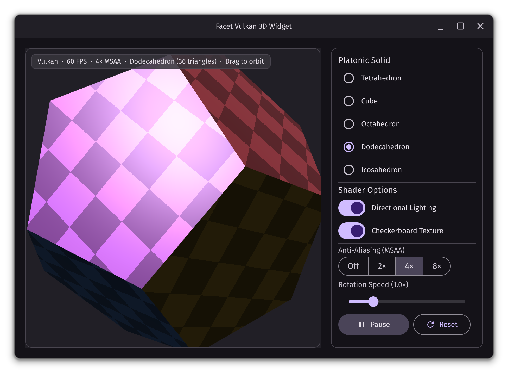

# Facet

**Facet** is a fast, efficient, and beautiful declarative UI toolkit for Zig.

It makes building modern desktop applications simple: describe your interface in clean Zig code and get a responsive, native Material 3 look and feel out of the box.

- [API Documentation](https://robert-ancell.github.io/facet/docs/)



## Features

- **Material 3 Design:** Rich set of widgets including layout containers, buttons, selection controls, text fields, code editor, dialogs, menus, tooltips, images, interactive maps, QR codes, and 3D views, with automatic light and dark themes.
- **Cross-Platform:** Runs natively on Linux, macOS, and Windows with HiDPI scaling, clipboard support, keyboard navigation, and accessibility.
- **Hardware Accelerated:** Renders smoothly using Vulkan, OpenGL, Metal, or Direct3D 11, with a built-in software renderer fallback.
- **Ready to Use:** Ships with bundled fonts, color emoji, and Material Icons so applications work immediately with no extra setup.

## Example

Add Facet to your project:

```sh
zig fetch --save git+https://github.com/robert-ancell/facet
```

Import the `facet` module in your `build.zig`:

```zig
const facet_dep = b.dependency("facet", .{ .target = target, .optimize = optimize });
exe.root_module.addImport("facet", facet_dep.module("facet"));
```

Then build your UI in `src/main.zig`:

```zig
const std = @import("std");
const facet = @import("facet");

pub const Counter = struct {
    pub const State = struct {
        count: i32 = 0,

        pub fn increment(s: *State) void {
            s.count += 1;
        }

        pub fn decrement(s: *State) void {
            s.count -= 1;
        }
    };

    pub fn build(_: *const Counter, cx: *facet.Context, state: *State) facet.Widget {
        return cx.make(facet.Center{
            .child = cx.make(facet.Column{
                .main_axis_size = .min,
                .cross_axis_alignment = .center,
                .spacing = 16,
                .children = &.{
                    cx.make(facet.Text{
                        .text = "Hello, Facet!",
                    }),
                    cx.make(facet.Text{
                        .text = cx.fmt("Count: {d}", .{state.count}),
                    }),
                    cx.make(facet.Row{
                        .main_axis_size = .min,
                        .spacing = 12,
                        .children = &.{
                            cx.make(facet.OutlinedButton{
                                .icon = .remove,
                                .on_press = .of(state, State.decrement),
                            }),
                            cx.make(facet.FilledButton{
                                .icon = .add,
                                .on_press = .of(state, State.increment),
                            }),
                        },
                    }),
                },
            }),
        });
    }
};

pub fn main(init: std.process.Init) !void {
    const app = try facet.App.init(init.gpa, init.io, init.minimal.environ, .{
        .on_quit_request = .quit,
        .on_last_window_closed = .quit,
    });
    defer app.deinit();
    const win = try app.openWindow(.{
        .title = "Hello Facet",
        .size = .{ 480, 320 },
        .on_close_request = .close,
    });

    while (try app.step(std.math.maxInt(u64))) {
        app.takeInput();
        try win.draw(Counter{});
    }
}
```

An app can have any number of windows (`app.openWindow` again, with a
`.parent` for a dialog's), each drawn with its own `draw`. What the
system asks for (to close a window, to quit) is the app's to act on: the
options above say to act on it as most apps do, or callbacks can decide
(`.on_close_request = .{ .call = .of(&state, State.askToSave) }`).

## Showcase

Run the interactive widget showcase from the repository root:

```sh
zig build run-showcase
```

## Special Thanks ❤️

Facet is built on the foundations of these great projects:

- [Zig](https://ziglang.org/)
- [Material Design](https://m3.material.io/)
